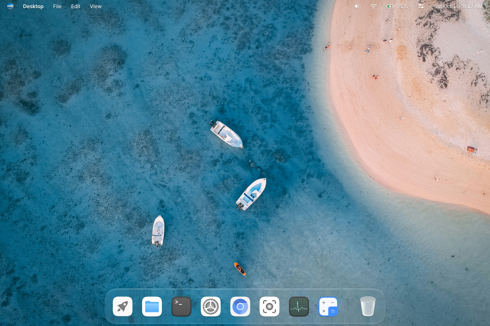

# Cutefish Compositor

The Cutefish Wayland compositor, with window management, the desktop shell,
the lock screen and Xwayland in one process. Its Wayland server and window
management are designed after Chromium's Exo and Ash.



## Dependencies

cutefish-toolkit, the cutefish-framework clients and libwayland 1.23 or newer.
At runtime it needs `adwaita-icon-theme` and `xwayland`. Tests also need
`libgtest-dev`.

## Build

```bash
mkdir build
cd build
cmake -DCMAKE_INSTALL_PREFIX:PATH=/usr ..
make
sudo make install
```

Pass `-DBUILD_TESTING=ON` to build the tests.

## Open-source references

Parts of the compositor were written with an open-source project as their
reference:

- `src/input/pointer_acceleration.cpp`: pointer acceleration curves,
  reimplemented from [IOHIDFamily](https://github.com/apple-oss-distributions/IOHIDFamily)
  (Apple Public Source License 2.0): `IOHIDParametricAcceleration`'s
  parametric curve. Its curve table is the `HIDAccelCurves` table of
  IOHIDFamily's generic HID pointer, converted from 16.16 fixed point, so
  the file is under the APSL 2.0; see [LICENSE.apsl](LICENSE.apsl).

## License

BSD-3-Clause; see [LICENSE](LICENSE). Files that follow Chromium's code keep
its notice in [LICENSE.chromium](LICENSE.chromium), code from sommelier
in [LICENSE.sommelier](LICENSE.sommelier), and
`src/input/pointer_acceleration.cpp` is under the APSL 2.0
([LICENSE.apsl](LICENSE.apsl)).
